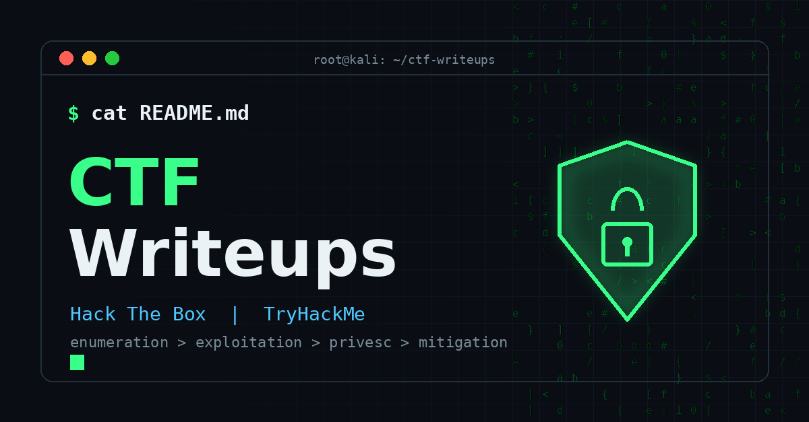

# Offensive Security Write-ups

Penetration testing and CTF write-ups covering Active Directory attacks, web exploitation, CVE weaponisation and Linux/Windows privilege escalation.

**Author:** MANASA
**Live site:** https://manasarangavalli28503.github.io/CTF-Writeups/

## Write-ups

| Machine | Platform | OS | Difficulty | Key techniques | Author | PDF |
|---|---|---|---|---|---|---|
| Mentor | Hack The Box | Linux | Medium | SNMP community brute force, FastAPI JWT, blind command injection, Docker → Postgres hash dump, password reuse, sudo sh → root | MANASA | [PDF](writeups/mentor.pdf) |
| Return | Hack The Box | Windows | Easy | Printer panel LDAP creds captured via rogue listener, WinRM, Server Operators service binpath abuse → SYSTEM | MANASA | [PDF](writeups/return.pdf) |
| Timelapse | Hack The Box | Windows | Easy | Anonymous SMB, zip2john/pfx2john cracking, WinRM cert auth, PS history creds, LAPS read → Admin | MANASA | [PDF](writeups/timelapse.pdf) |
| Monteverde | Hack The Box | Windows | Medium | Password spray, readable SMB share, Azure XML creds, Azure AD Connect ADSync dump → DA | MANASA | [PDF](writeups/monteverde.pdf) |
| Intentions | Hack The Box | Linux | Hard | Second-order SQLi, hash login abuse, Imagick MSL write, git history creds | MANASA | [PDF](writeups/intentions.pdf) |
| Forest | Hack The Box | Windows | Easy | RPC enum, AS-REP roasting, BloodHound, Exchange ACL → DCSync | MANASA | [PDF](writeups/forest.pdf) |
| Sauna | Hack The Box | Windows | Easy | username-anarchy, AS-REP roasting, Evil-WinRM, DCSync, PtH | MANASA | [PDF](writeups/sauna.pdf) |
| Active | Hack The Box | Windows | Easy | Anonymous SMB, GPP cpassword, Kerberoasting | MANASA | [PDF](writeups/active.pdf) |
| Outbound | Hack The Box | Linux | Easy | Roundcube CVE-2025-49113, mailbox credential harvesting | MANASA | [PDF](writeups/outbound.pdf) |
| Broker | Hack The Box | Linux | Easy | ActiveMQ CVE-2023-46604, sudo nginx misconfig | MANASA | [PDF](writeups/broker.pdf) |
| Sau | Hack The Box | Linux | Easy | Request-Baskets SSRF, Maltrail RCE, systemctl pager escape | MANASA | [PDF](writeups/sau.pdf) |
| Busqueda | Hack The Box | Linux | Easy | Searchor command injection, .git creds, relative path hijack | MANASA | [PDF](writeups/busqueda.pdf) |
| Help | Hack The Box | Linux | Easy | HelpDeskZ upload bypass, kernel exploit | MANASA | [PDF](writeups/help.pdf) |
| Smol | TryHackMe | Linux | Medium | WordPress plugin LFI, backdoor RCE, hash & zip cracking | MANASA | [PDF](writeups/smol.pdf) |
| Wonderland | TryHackMe | Linux | Medium | Python library hijack, PATH hijack, perl capabilities | MANASA | [PDF](writeups/wonderland.pdf) |
| Cheese CTF | TryHackMe | Linux | Easy | LFI, PHP filter chain RCE, systemd timer, SUID xxd | MANASA | [PDF](writeups/cheese-ctf.pdf) |
| Lookup *(pentest report)* | TryHackMe | Linux | Easy | wfuzz, Hydra, elFinder CVE-2019-9194, SUID PATH hijack | MANASA | [PDF](writeups/lookup-pentest-report.pdf) |
| Pyrat | TryHackMe | Linux | Easy | Python RCE service, custom socket brute-forcer | MANASA | [PDF](writeups/pyrat.pdf) |
| SQLi, XSS & CSRF Labs | Web Security | Web | Medium | XML-encoded SQLi WAF bypass, stored XSS → CSRF | MANASA | [PDF](writeups/portswigger-sqli-xss-csrf.pdf) |

## Tooling

Nmap · Burp Suite · Caido · sqlmap · gobuster · dirsearch · wfuzz · Hydra · Impacket · BloodHound · Evil-WinRM · Hashcat · John the Ripper · linpeas

---

*All write-ups cover retired or lab machines and are published for educational purposes only.*
